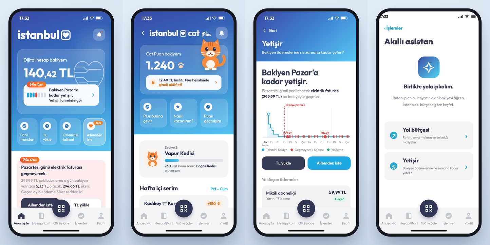
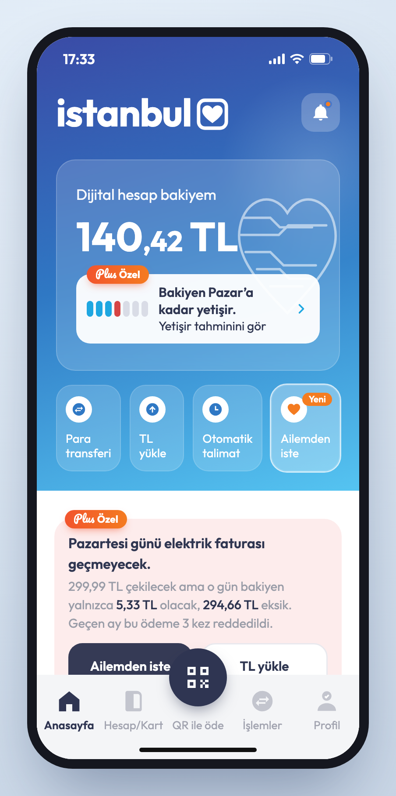
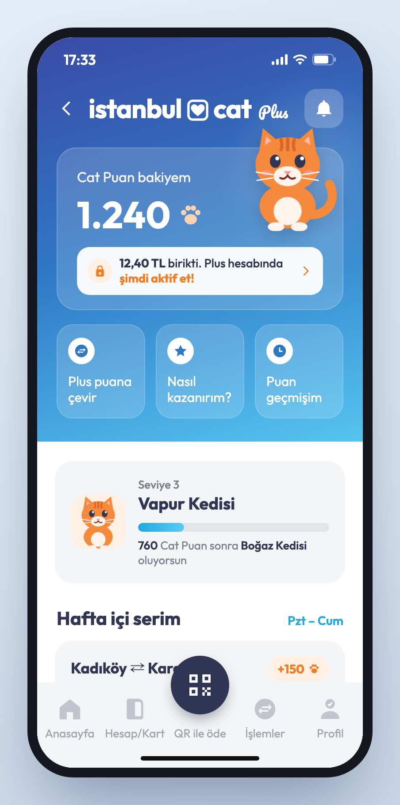
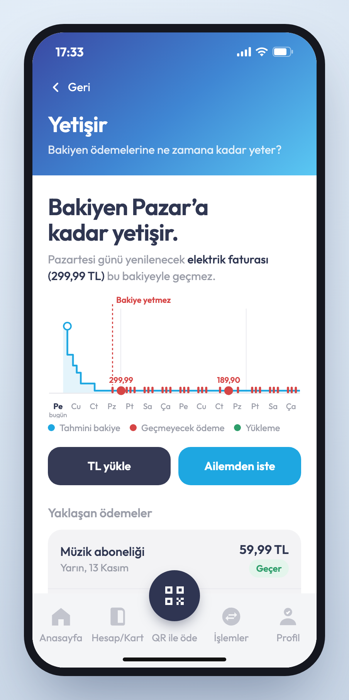
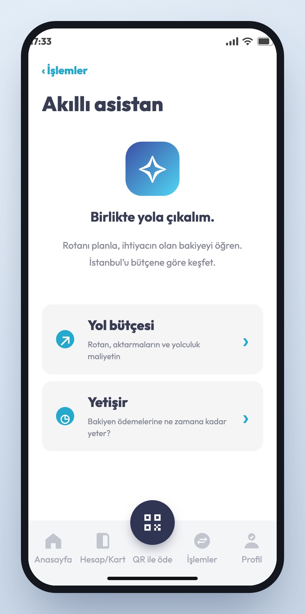

# istanbul ♥ cat Plus

İstanbulkart mobil uygulaması için hazırlanmış, tıklanabilir bir **konsept prototip**. Toplu taşıma kullanımını oyunlaştıran **Cat Puan**, bakiyenin ne zamana kadar yeteceğini tahmin eden **Yetişir** ve rota ile yol bütçesini planlayan **Akıllı Asistan** özelliklerini tek bir uygulama deneyiminde bir araya getirir.

**▶ Canlı demo:** https://erenciftci22.github.io/istanbul-cat-plus/
**▶ Açılış animasyonu (sesli):** https://erenciftci22.github.io/istanbul-cat-plus/animasyon.html

## Özellikler

| Özellik | Ne yapar |
|---|---|
| **Cat Puan** | Yolculuklar ve görevlerle puan kazanılır. Seviye atladıkça kedi maskot değişir (Vapur Kedisi → Boğaz Kedisi…), puanlar Plus puanına ve TL'ye çevrilebilir. |
| **Yetişir** | Harcama geçmişi ve düzenli ödemelerden yola çıkarak bakiyenin hangi güne kadar yeteceğini tahmin eder; geçmeyecek ödemeler için önceden uyarır, "TL yükle" ve "Ailemden iste" seçenekleri sunar. |
| **Akıllı Asistan** | Harita üzerinde rota planlar; aktarmalara göre yolculuk maliyetini (yol bütçesini) hesaplar. |
| **istanbul → cat Plus animasyonu** | Kedinin pençesiyle harflerin düştüğü, miyav sesli marka geçiş animasyonu. |

### Yetişir tahmini nasıl çalışıyor?
Kullanıcının geçmiş harcama tutarları, işlem sıklığı ve haftanın günlerine göre değişen harcama düzeni **CatBoost regresyon modeliyle** analiz edilir. Tahmin edilen harcamalar ve bilinen düzenli ödemeler mevcut bakiyeden sırayla düşülerek, bakiyenin bir sonraki ödemeyi karşılayamayacağı ilk tarih hesaplanır. Prototipte bu tahmin örnek verilerle gösterilmektedir.

## Teknik

- Tek dosya **HTML + CSS + JavaScript**; framework veya kurulum gerektirmez.
- Animasyonlar: Web Animations API, CSS geçişleri ve SVG ile çizilmiş maskot.
- Ses: Web Audio API ile kodla üretilen miyav sesi (ses dosyası yok).
- Harita: Leaflet.js ve OpenStreetMap; rota hesabı Dijkstra algoritmasıyla.
- Uygulama durumu tarayıcının `localStorage`'ında tutulur.

## Yerelde çalıştırma

Depoyu indirip `index.html` dosyasını çift tıklayarak tarayıcıda açmanız yeterli.

## Ekranlar

| Anasayfa | Cat Puan | Yetişir | Akıllı Asistan |
|---|---|---|---|
|  |  |  |  |

---

> Bu proje bağımsız bir konsept çalışmasıdır; İstanbulkart, İBB veya Belbim'in resmi bir ürünü değildir. Ekranlardaki bakiye, işlem ve kullanıcı bilgileri örnek verilerdir.
